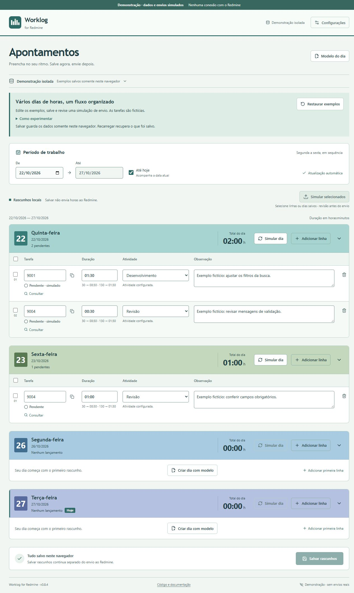

# Worklog for Redmine

[](https://github.com/cristianworth/worklog-for-redmine/actions/workflows/verify.yml)
[](LICENSE)

Organize several days of time-entry drafts, check daily totals, and explicitly review before submitting to Redmine. Built from a personal spreadsheet workflow where hours are reconstructed together and submitted later.

**[Try the live demo](https://cristianworth.github.io/worklog-for-redmine/)** · [Local usage](docs/local-usage.md) · [Architecture](docs/architecture.md) · [Contributing](CONTRIBUTING.md)

The interface is in Brazilian Portuguese. This overview is in English; the detailed product guides are in Portuguese. The demo uses fictional data and simulated submissions. No account, Redmine key or installation is required.



## Try it in a few minutes

1. Edit one of the three example days. Fictional task IDs: **9001**, **9004**, **9007**.
2. Use **Salvar rascunhos** to persist your changes in this browser.
3. Choose **Simular dia**, or select rows across several dates and use **Simular selecionados**.
4. Review and confirm. Results are labeled **Simulado**; **Ver resultado** lets you check a saved receipt without creating another.
5. Reload to recover saved work. **Restaurar exemplos** asks before discarding the demo's saved data and open edits.

## What it does

- A free date range showing Monday–Friday, with stacked days and a duration total per day. Historical weekend data stays stored.
- Fully appropriated days start collapsed; pending or uncertain days stay expanded. You can expand/collapse any day.
- Compact duration input: `30` → `00:30`, `130` → `01:30`; integer minutes internally.
- One activity catalog, available before looking up a task; selectors show names only. IDs remain available in settings and submission review.
- A reusable day template, copied explicitly into untouched dates.
- Saved-row selection, review, confirmation and sequential batches with partial results.
- Protected receipts, conservative duplicate checks and read-only recovery after uncertain results.

Saving and submitting are separate actions. Issue statuses stay unchanged. This project is independent of Redmine.

## Two modes, one interface

| | Public demo | Local application |
| --- | --- | --- |
| Runs on | GitHub Pages, static files | Node.js on your computer |
| Data | Fictional examples; this browser's storage | Your drafts and receipts in SQLite |
| Submission | Simulated; no operational network access | Redmine API after review and confirmation |
| Credentials | None | Optional private `.env`, read only by Node |
| Recovery | Reload saved data or restore examples | Preserve receipts and back up SQLite |

Clearing site data loses demo history. Browsers without Web Locks show a one-tab-at-a-time notice. Reloading never resumes an interrupted batch automatically. The demo illustrates the workflow; it does not validate real Redmine permissions or availability.

## Run locally

Requires **Node.js 24.20 or newer within 24.x**, and npm.

```sh
git clone https://github.com/cristianworth/worklog-for-redmine.git
cd worklog-for-redmine
npm ci
npm run dev
```

Open **http://127.0.0.1:3000**. A fresh installation starts with an empty local catalog and no imported examples. Draft editing works without Redmine configuration. Follow the [local usage guide](docs/local-usage.md) to configure the API, register activities, back up data and submit hours deliberately.

To run the built local interface, stop the development server, then run `npm run build` and `npm start`. Both use port 3000; `PORT` can override it. Do not expose this personal local server to the public Internet.

For a backend-free demo preview:

```sh
npm run build:demo
npm run check:demo
npm run preview:demo
```

Open **http://127.0.0.1:4173/**. To reproduce the deployed subdirectory, use `npm run build:pages`, `npm run check:demo -- /worklog-for-redmine/` and `npm run preview:pages`, then open **http://127.0.0.1:4174/worklog-for-redmine/**. Both demo builds use `dist-demo/`; the latest build replaces the previous one. The local build uses `dist/`.

## Engineering choices

React, TypeScript and Vite provide the editor; Express and Node's built-in SQLite module keep the local service small. A typed data-access contract selects HTTP or the browser simulation at startup. Shared validators preserve duration, catalog and review rules across both modes.

Explicit saves and revision checks protect pending edits. Submission first persists a started receipt, then accepts only the service's verified creation contract. A batch validates the whole selection before its first write, runs sequentially and preserves partial successes. Uncertain creation is reconciled by reading, never by automatic retry.

The demo build skips `.env`, excludes server/HTTP/private modules and includes a CSP blocking operational network connections. Deployment uploads only the audited static artifact. No shared backend, authentication system or telemetry was added for the portfolio. See [architecture and trade-offs](docs/architecture.md).

## Verify and contribute

```sh
npm test
npm run build
npm run build:demo
npm run check:demo
npm run build:pages
npm run check:demo -- /worklog-for-redmine/
```

CI repeats these checks; only verified `master` builds from this repository deploy. Pull requests run checks without publishing. Tests use temporary stores and fictional services. Never send real hours as a routine test. See [contributing](CONTRIBUTING.md), [security boundaries](SECURITY.md) and [deployment/recovery](docs/deployment.md).

## Documentation and status

- [Documentation map](docs/README.md): current guides and historical references.
- [Changelog](CHANGELOG.md): delivered releases; the footer reads the version from `package.json`.
- [Roadmap](ROADMAP.md): priorities, completed milestones and remaining visitor feedback.

The legacy spreadsheet, VBA, keys, local databases, backups and session handoffs are excluded from this repository. Public examples are created from scratch. Repository history is preserved; older project-specific activity mappings are superseded by the single catalog introduced in v0.4.0.

## License

[MIT](LICENSE), copyright 2026 Cristian Weissmantel. Dependencies retain their own licenses. The private spreadsheet, VBA and local data are not distributed.
